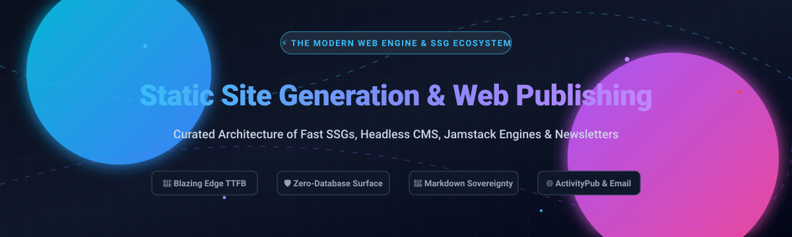

<div align="center">



# ⚡ Awesome Static Site Generation & Web Publishing 🌐

<p align="center">
  <a href="https://github.com/ishandutta2007/Awesome-Awesome-Awesome"></a>
  <a href="https://discord.gg/jc4xtF58Ve"></a>
  <a href="https://github.com/ishandutta2007/Awesome-Awesome-Awesome"></a>
  <a href="http://creativecommons.org/publicdomain/zero/1.0/"></a>
  <a href="https://github.com/ishandutta2007/Awesome-Static-Site-Generation-Web-Publishing"></a>
  <a href="https://github.com/ishandutta2007"></a>
</p>

**Curated ecosystem of Static Site Generators (SSGs), Jamstack engines, headless CMS, self-hosted newsletter platforms, and modern web publishing tools.**

*Crafted for writers, technical bloggers, web developers, indie hackers, and digital publishing teams seeking blistering performance, rock-solid security, high SEO visibility, and full content sovereignty.* 🚀

</div>

---

## 📑 Table of Contents

- [📊 Sector Overview & Market Dynamics](#-sector-overview--market-dynamics)
- [☁️ Hosted SaaS Publishing Platforms](#️-hosted-saas-publishing-platforms)
- [🏗️ Modern Architecture & Flow](#️-modern-architecture--flow)
- [🌟 Open-Source GitHub Projects](#-open-source-github-projects)
  - [🔥 Full-Stack Web Frameworks & Static Enablers](#-full-stack-web-frameworks--static-enablers)
  - [⚡ Dedicated Static Site Generators (SSGs)](#-dedicated-static-site-generators-ssgs)
  - [📚 Documentation & Technical Publishing Engines](#-documentation--technical-publishing-engines)
  - [📝 Headless CMS & Git-Backed Editorial Portals](#-headless-cms--git-backed-editorial-portals)
  - [💌 Self-Hosted Newsletters & ActivityPub Publishing](#-self-hosted-newsletters--activitypub-publishing)
  - [🎨 Open-Source Visual Web Builders](#-open-source-visual-web-builders)
  - [📊 Privacy-First Analytics & Static Site Comments](#-privacy-first-analytics--static-site-comments)
- [🛠️ Recommended Production Stacks](#️-recommended-production-stacks)
- [🤝 How to Contribute](#-how-to-contribute)
- [💖 Support & Sponsorship](#-support--sponsorship)
- [📈 Star History](#-star-history)
- [⚖️ Disclaimer & Best Practices](#️-disclaimer--best-practices)

---

## 📊 Sector Overview & Market Dynamics

The global web publishing, content management systems (CMS), and digital experience platforms (DXP) market is valued at approximately **$24.5 billion** and is projected to expand at a compound annual growth rate (CAGR) of over **11.8%** through 2032. 

The sector is **moderately fragmented**: enterprise-scale content distribution and hosted visual site building exhibit strong oligopolistic concentration led by dominant legacy giants and high-valuation SaaS suites (such as Automattic/WordPress, Wix, and Squarespace), whereas the static generation, developer-first blogging, and Jamstack headless layer remain vibrantly decentralized, propelled by open-source innovation, zero-runtime frameworks, and edge content networks.

---

## ☁️ Hosted SaaS Publishing Platforms

The table below lists notable hosted publishing suites, sorted in descending order by company valuation or annual recurring revenue (ARR):

| Platform 🌐 | Scale (Valuation / Revenue) 💰 | Starting Paid Tier 🏷️ | Free Tier Limits 🎁 | Primary Publishing Focus 🎯 |
| :--- | :--- | :--- | :--- | :--- |
| **[Wix Studio](https://wix.com/studio)** | ~$10.2B Market Cap (Wix) | $17 / month (Light plan) | Free forever plan: 500 MB cloud storage, 500 MB bandwidth, Wix-branded banner & subdomain | All-in-one responsive web creation, client management, and agency portfolios |
| **[Squarespace](https://squarespace.com)** | ~$6.9B Valuation (Acquired by Permira) | $16 / month (Personal billed annually) | 14-day free trial with full CMS feature access, unlimited draft pages, no custom domain | Designer marketing sites, portfolios, blogs, and creator e-commerce stores |
| **[Webflow](https://webflow.com)** | ~$4.0B Valuation (Series C) | $14 / month (Basic site plan billed annually) | Free forever Starter plan: 2 static pages, 50 CMS collection items, 1 GB bandwidth, webflow.io domain | Visual CSS/HTML design platform, animations, and high-craft marketing sites |
| **[WordPress VIP](https://wpvip.com)** | ~$3.0B Parent Valuation (Automattic) | $25,000 / year (Enterprise base tier) | 30-day proof-of-concept trial upon enterprise sales onboarding; no permanent free tier | Ultra-high-traffic enterprise newsrooms, major media publishers, and global brands |
| **[Framer](https://framer.com)** | ~$2.0B Valuation | $5 / month per site (Mini plan billed annually) | Free forever Hobby plan: Framer banner, framer.photos domain, 1,000 visitors/month, 2 pages | Interactive no-code site builder, micro-interactions, and visual landing pages |
| **[Medium](https://medium.com)** | ~$600M Valuation | $5 / month or $50 / year (Member tier) | Free forever reader/author account: unlimited story publishing, up to 3 metered paywall stories/month | Social publishing network with built-in syndication and partner monetization |
| **[Substack](https://substack.com)** | ~$585M Valuation | 10% fee on paid subscriber revenue ($0 upfront) | Free forever publishing: unlimited free newsletter subscribers, podcasts, and community posts | Independent paid subscriptions, email newsletters, and long-form essays |
| **[Hashnode](https://hashnode.com)** | ~$100M Valuation | $9 / month (Team / Pro billed annually) | Free forever personal tier: unlimited articles, custom domain mapping, newsletter delivery | Developer blogging network with built-in markdown sync and technical readership |
| **[Dev.to (Forem Hosted)](https://dev.to)** | ~$40M Valuation | Free (Community supported & sponsored) | Free forever membership: unlimited technical articles, community discussions, and tag syndication | Software developer community blogging, open-source tutorials, and tech career guides |

---

## 🏗️ Modern Architecture & Flow

Decoupling the editorial writing interface from static presentation completely eliminates backend database overhead and maximizes edge delivery:

```
┌─────────────────────────────────┐
│  Markdown / MDX / Headless CMS  │  <-- Plaintext & Content Sovereignty
└────────────────┬────────────────┘
                 │ (Git Commit / Webhook Trigger)
                 ▼
┌─────────────────────────────────┐
│ Static Site Generator & Bundler │  <-- Astro, Hugo, Eleventy, Zola, VitePress
└────────────────┬────────────────┘
                 │ (HTML / CSS / WebP Flat Assets)
                 ▼
┌─────────────────────────────────┐
│ Global Edge CDN (Anycast Cache) │  <-- Cloudflare Pages, Vercel, Netlify, GitHub Pages
└─────────────────────────────────┘
```

### ⚡ Key Architectural Advantages:
- 🚀 **Core Web Vitals & Instant TTFB**: 100/100 Lighthouse performance with pre-rendered HTML and minimal JavaScript overhead.
- 🛡️ **Zero Dynamic Attack Surface**: Immune to SQL injections, server-side execution bugs, and database connection timeouts.
- 💸 **Infinitely Scalable & Cost-Efficient**: Handles viral traffic spikes effortlessly on edge caching networks for fractions of a penny.
- 🔒 **Long-Term Data Portability**: Markdown and frontmatter repositories remain readable and editable forever without proprietary database lock-in.

---

## 🌟 Open-Source GitHub Projects

All open-source tools below are organized by primary functional archetype and **sorted in descending order by GitHub star count** within each tier.

### 🔥 Full-Stack Web Frameworks & Static Enablers
*Hybrid and full-stack frameworks offering best-in-class static site generation (SSG) and pre-rendering modes.*

- **[Next.js](https://nextjs.org/)** — [](https://github.com/vercel/next.js/stargazers) — The React framework for the Web with built-in static exports (`next export`) and hybrid static generation.
- **[Astro](https://astro.build/)** — [](https://github.com/withastro/astro/stargazers) — Modern web framework for content-driven sites utilizing Islands Architecture to ship zero client-side JavaScript by default.
- **[Nuxt](https://nuxt.com/)** — [](https://github.com/nuxt/nuxt/stargazers) — The intuitive Vue framework with comprehensive static site generation capabilities and module ecosystems.
- **[Gatsby](https://www.gatsbyjs.com/)** — [](https://github.com/gatsbyjs/gatsby/stargazers) — Pioneering React-based static site generator with a unified GraphQL data layer for headless CMS sourcing.
- **[SvelteKit](https://kit.svelte.dev/)** — [](https://github.com/sveltejs/kit/stargazers) — Rapid web development framework for Svelte offering static site generation via `@sveltejs/adapter-static`.

### ⚡ Dedicated Static Site Generators (SSGs)
*Purpose-built standalone static site generation engines focused on speed, zero dependencies, and markdown authoring.*

- **[Ponytail](https://github.com/dietrichgebert/ponytail)** — [](https://github.com/dietrichgebert/ponytail/stargazers) — AI coding agent ruleset and guidelines prioritizing standard library primitives and YAGNI to keep static web builds lean.
- **[Hugo](https://gohugo.io/)** — [](https://github.com/gohugoio/hugo/stargazers) — Ultra-fast Go-based static engine building thousands of pages in milliseconds with built-in asset bundling and i18n.
- **[Jekyll](https://jekyllrb.com/)** — [](https://github.com/jekyll/jekyll/stargazers) — Battle-tested Ruby static site generator that powers GitHub Pages natively using Liquid templates and Markdown.
- **[Hexo](https://hexo.io/)** — [](https://github.com/hexojs/hexo/stargazers) — Fast, simple, and powerful Node.js blogging framework with blazing-fast Markdown parsing and rich plugin ecosystems.
- **[Eleventy (11ty)](https://www.11ty.dev/)** — [](https://github.com/11ty/eleventy/stargazers) — Zero-client-JS JavaScript static site generator supporting Markdown, Liquid, Nunjucks, and WebC.
- **[Zola](https://www.getzola.org/)** — [](https://github.com/getzola/zola/stargazers) — Single-binary Rust static site generator with built-in Sass compilation, Tera templates, and syntax highlighting.
- **[Pelican](https://getpelican.com/)** — [](https://github.com/getpelican/pelican/stargazers) — Mature Python static site generator supporting Markdown and reStructuredText with Jinja2 templates.
- **[Lektor](https://www.getlektor.com/)** — [](https://github.com/lektor/lektor/stargazers) — Flexible Python-based static file CMS featuring an intuitive local administrative desktop GUI.

### 📚 Documentation & Technical Publishing Engines
*Specialized static site systems engineered for technical documentation, book publishing, and developer knowledge bases.*

- **[Docusaurus](https://docusaurus.io/)** — [](https://github.com/facebook/docusaurus/stargazers) — React & MDX documentation engine built by Meta with out-of-the-box versioning, search, and localization.
- **[Slidev](https://sli.dev/)** — [](https://github.com/slidevjs/slidev/stargazers) — Developer-focused presentation slide generator converting Markdown into interactive, beautiful HTML/Vue slides.
- **[Material for MkDocs](https://squidfunk.github.io/mkdocs-material/)** — [](https://github.com/squidfunk/mkdocs-material/stargazers) — Beautiful technical documentation system for Python's MkDocs with deep client-side search and dark mode.
- **[VitePress](https://vitepress.dev/)** — [](https://github.com/vuejs/vitepress/stargazers) — Vite and Vue-powered static documentation generator offering instant hot reloading and minimal styling.

### 📝 Headless CMS & Git-Backed Editorial Portals
*Editorial user interfaces providing non-technical writers with visual CMS controls over Markdown files and API endpoints.*

- **[Strapi](https://strapi.io/)** — [](https://github.com/strapi/strapi/stargazers) — Leading customizable open-source headless CMS built on Node.js with RESTful and GraphQL APIs for static frontends.
- **[Directus](https://directus.io/)** — [](https://github.com/directus/directus/stargazers) — Real-time headless CMS and data engine that wraps any SQL database with dynamic GraphQL and REST endpoints.
- **[Decap CMS](https://decapcms.org/)** — [](https://github.com/decaporg/decap-cms/stargazers) — Git-backed single-page editorial interface storing content commits directly in GitHub or GitLab.
- **[TinaCMS](https://tina.io/)** — [](https://github.com/tinacms/tinacms/stargazers) — Git-backed headless CMS supporting real-time visual editing and structured content modeling for React and Next.js.
- **[Publii](https://getpublii.com/)** — [](https://github.com/GetPublii/Publii/stargazers) — Desktop static CMS for macOS, Windows, and Linux that compiles static sites locally and publishes via SFTP, Git, or S3.
- **[Pages CMS](https://pagescms.org/)** — [](https://github.com/pages-cms/pages-cms/stargazers) — Fast, elegant open-source web CMS tailored specifically for Markdown files and GitHub-hosted repositories.

### 💌 Self-Hosted Newsletters & ActivityPub Publishing
*Independent blogging suites and newsletter managers for building subscriber lists and sovereign social publishing nodes.*

- **[Ghost](https://ghost.org/)** — [](https://github.com/TryGhost/Ghost/stargazers) — Open-source publishing, newsletter, and paid membership platform deployable as a standalone app or headless CMS.
- **[Listmonk](https://listmonk.app/)** — [](https://github.com/knadh/listmonk/stargazers) — High-performance self-hosted newsletter and mailing list manager written in Go with single-binary deployment.
- **[Forem](https://forem.com/)** — [](https://github.com/forem/forem/stargazers) — Open-source Ruby on Rails community publishing engine powering Dev.to and federated developer spaces.
- **[WriteFreely](https://writefreely.org/)** — [](https://github.com/writefreely/writefreely/stargazers) — Minimalist, distraction-free federated blogging platform written in Go with native ActivityPub / Fediverse support.

### 🎨 Open-Source Visual Web Builders
*No-code page builders and visual editors that export clean, semantic static HTML/CSS.*

- **[GrapesJS](https://grapesjs.com/)** — [](https://github.com/GrapesJS/grapesjs/stargazers) — Next-generation multi-purpose visual web builder framework for building drag-and-drop web and newsletter editors.
- **[Webstudio](https://webstudio.is/)** — [](https://github.com/webstudio-is/webstudio/stargazers) — Open-source visual website builder and Webflow alternative that outputs clean, standard-compliant code.

### 📊 Privacy-First Analytics & Static Site Comments
*Lightweight, privacy-respecting client add-ons designed for static sites.*

- **[Umami](https://umami.is/)** — [](https://github.com/umami-software/umami/stargazers) — Simple, fast, privacy-focused open-source alternative to Google Analytics with no cookies.
- **[Plausible Analytics](https://plausible.io/)** — [](https://github.com/plausible/analytics/stargazers) — Lightweight, GDPR-compliant web analytics dashboard with zero tracking cookies.
- **[Giscus](https://giscus.app/)** — [](https://github.com/giscus/giscus/stargazers) — Lightweight commenting system powered by GitHub Discussions for static web blogs.
- **[Remark42](https://remark42.com/)** — [](https://github.com/umputun/remark42/stargazers) — Privacy-focused, self-hosted commenting engine with social and anonymous login options.

---

## 🛠️ Recommended Production Stacks

| Use Case 🎯 | SSG / Framework ⚡ | CMS / Editorial ✍️ | Comments & Analytics 💬 | Edge Hosting 🚀 |
| :--- | :--- | :--- | :--- | :--- |
| **Engineering Blog** | [Astro](https://astro.build/) | [Pages CMS](https://pagescms.org/) / Git | Giscus + Umami | Cloudflare Pages / Vercel |
| **High-Volume Content Magazine** | [Hugo](https://gohugo.io/) | Decap CMS | Remark42 + Plausible | Netlify / GitHub Pages |
| **Developer Documentation Portal** | [Docusaurus](https://docusaurus.io/) | Markdown / Git | Algolia DocSearch | GitHub Pages / Cloudflare |
| **Independent Paid Publication** | [Ghost](https://ghost.org/) | Ghost Admin | Native Memberships | DigitalOcean / Hetzner VPS |
| **Self-Hosted Newsletter Funnel** | [Eleventy](https://www.11ty.dev/) | Markdown | [Listmonk](https://listmonk.app/) | Cloudflare Pages + Docker |

---

## 🤝 How to Contribute

Contributions are warmly welcomed! 🌟 Follow these steps:

1. 🍴 **Fork** this repository.
2. 🌿 **Create a feature branch**: `git checkout -b feature/add-new-tool`.
3. 📝 **Add/Update entries** in `README.md` following the established formatting rules:
   - Official tool name and home URL.
   - For open-source projects, include the social star badge linking to `/stargazers`.
   - Maintain sorting by GitHub stars (descending) in each category.
   - For SaaS tools, supply precise starting pricing and free tier/trial limits.
4. 🚀 **Submit a Pull Request** with a concise description of your additions.

---

## 💖 Support & Sponsorship

If this curated index helped you discover static site generators, launch an independent blog, or build a faster web publishing pipeline, please consider supporting the project! ⭐

- ⭐ **Star this repository** to improve its visibility for other developers.
- 🍴 **Fork & Share** it with your technical teams, communities, and newsletters.
- ☕ **Buy a Coffee & Sponsor Development**: Support continued maintenance and curated open-source research through the **[GitHub Sponsors Dashboard](https://github.com/sponsors/ishandutta2007)**.

Thank you to all our contributors, sponsors, and community members! 💙

---

## 📈 Star History

[](https://star-history.com/#ishandutta2007/Awesome-Static-Site-Generation-Web-Publishing&type=date&legend=top-left)

---

## ⚖️ Disclaimer & Best Practices

- **Community Maintained**: This directory is curated for informational purposes and does not represent a commercial endorsement.
- **Dependency & Plugin Auditing**: Always audit third-party plugins, themes, and npm/Go dependencies prior to deploying static build pipelines in production.
- **Email Infrastructure**: Self-hosted newsletter platforms (e.g., Listmonk) require proper DNS security records (SPF, DKIM, DMARC, and PTR) for high inbox deliverability.
- **Content Portability**: Always retain local Git backups of all raw Markdown, images, and frontmatter to keep your publication permanently sovereign.

---

<div align="center">

**Made with ❤️ for independent writers, developers, and open-source publishers.**

</div>
